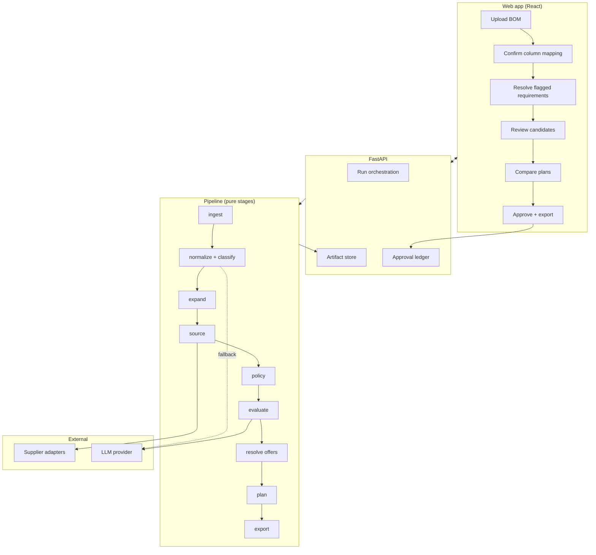

# Architecture

## Shape of the system



## Stage contract

Every stage is a pure function:

```python
def run(inp: InputArtifact, ctx: StageContext) -> StageResult[OutputArtifact]:
    ...
```

- No stage mutates its input.
- No stage performs I/O except `source` (supplier adapters) and the two LLM-backed
  stages (`normalize` fallback, `evaluate`).
- Every stage writes its output to `runs/<run_id>/<seq>-<stage>.json` alongside a
  `meta.json` recording inputs hash, config hash, duration, model/adapter versions.
- Any stage can be re-run from the previous artifact. This makes the system
  debuggable in production: an engineer reports a bad recommendation, you replay
  exactly that run.

## Stage responsibilities

| Stage | Input | Output | LLM |
|---|---|---|---|
| `ingest` | file bytes | `IngestResult` (`BomLine[]` + `MappingProposal`) | fallback only, not yet wired (M1) |
| `normalize` | `IngestResult` | `NormalizedRequirement[]` | fallback only, for rows with no usable category signal at all (M2) |
| `expand` | `NormalizedRequirement[]` | `SourcingQuery[]` | no |
| `source` | `SourcingQuery[]` | `PartCandidate[]` | no |
| `policy` | `PartCandidate[]` | filtered + tiered | no |
| `evaluate` | surviving candidates | + `rationale` | yes |
| `resolve` | candidates | + `SupplierOffer[]` | no |
| `plan` | candidates + offers | `PurchasePlan[]` | no |
| `export` | approved plan | `SupplierExport[]` | no |

Note that `policy` runs **before** `evaluate`. The model never sees a candidate that
violates an engineering rule, so it cannot argue for one.

**`normalize` and `classify` are one registered stage, not two** (`src/pcbpick/normalize/stage.py:NormalizeStage`).
Category routing (`src/pcbpick/classify/`) has to run *before* value parsing — the
same letter or 3-digit code means different things on a resistor than a capacitor —
and required-parameter validation has to run *after* parsing, so splitting them into
separate pipeline stages would require inventing an intermediate artifact with no
other consumer. `classify`'s router and criticality modules are called from within
the `normalize` stage instead. See `docs/decision-log.md` § M2.

## Sourcing adapters

```python
class SupplierAdapter(Protocol):
    supplier_id: SupplierId

    def search(self, query: SourcingQuery) -> list[CatalogHit]: ...
    def details(self, mpn: str) -> CatalogPart | None: ...
    def offers(self, sku: str, quantity: int) -> list[SupplierOffer]: ...
```

Implementations:

- `FixtureAdapter` — reads pinned JSON snapshots from `fixtures/catalogs/`. The only
  adapter used in tests and evals. Built first.
- `MouserAdapter`, `DigiKeyAdapter`, `FarnellAdapter` — added when API credentials
  exist. Each wraps the live API in a caching layer that writes new snapshots.

The cache is snapshot-addressed, not time-addressed: a run pins `snapshot_id` values
and can be replayed months later against the exact catalog state it saw. This is the
primary defense against the volatile-inventory problem.

## LLM usage boundary

Two call sites only, both structured-output with schema validation and bounded retry:

1. **`normalize` fallback** — a row the deterministic parser could not handle. The
   model returns a `NormalizedRequirement` fragment; every field it produces is tagged
   `source: llm_inferred` and surfaced for engineer confirmation.
2. **`evaluate`** — given a requirement and a policy-approved candidate, produce a
   human-readable rationale and flag concerns. The model cannot add, remove, or
   reorder candidates; its output is attached to candidates, not authoritative over
   them.

Validation failures retry up to `llm.max_retries`, then the item is flagged for human
review. A failed LLM call degrades the run; it never fails it.

## Persistence

| Store | Contents |
|---|---|
| Object storage / disk | Run artifacts, uploaded BOMs, generated exports |
| PostgreSQL | Runs, projects, engineer approvals, catalog snapshot index, offer cache |

The approval ledger is append-only. An export is always reconstructible from
`(plan_hash, snapshot_ids, approval record)`.

## Security posture

- BOMs are confidential design data. Uploads are scoped to a project; access is
  checked on every artifact read, not just at upload.
- Supplier API credentials live in the secret store, are never written to run
  artifacts, and are never included in LLM prompts.
- BOM content sent to the LLM is limited to the specific rows needing interpretation —
  never the whole file, never reference designator maps, never project identifiers.
- Uploaded files are parsed with hardened readers (no formula evaluation, no external
  workbook links, size and sheet-count limits).
- Generated exports are validated against the supplier schema before download; no
  user-controlled value is ever interpolated into a CSV cell without neutralizing
  leading `=`, `+`, `-`, `@` to prevent spreadsheet formula injection.
